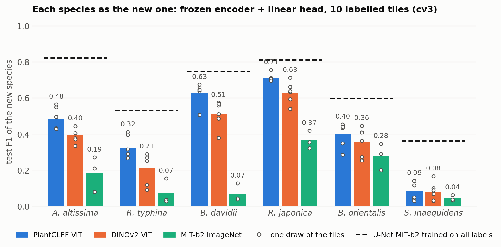
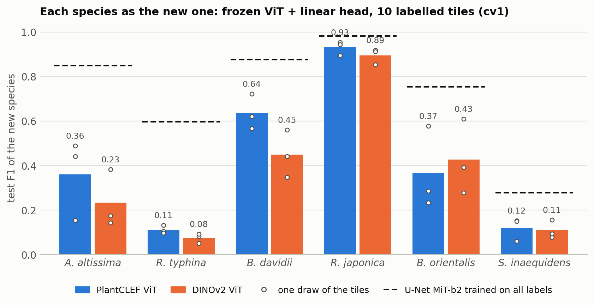
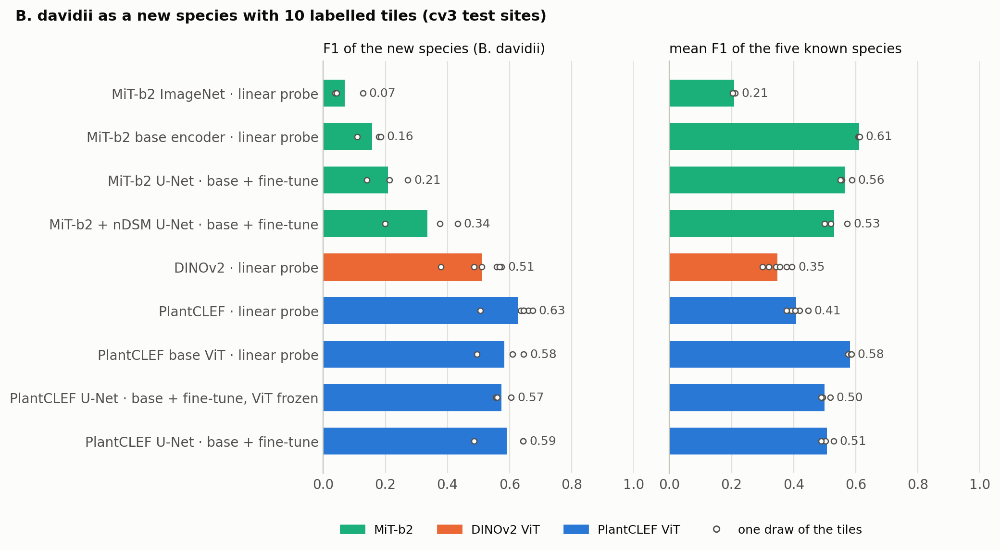
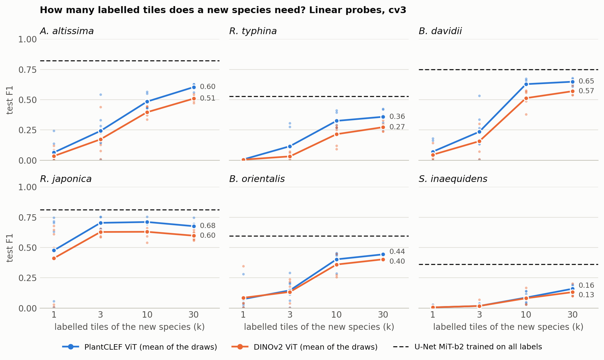
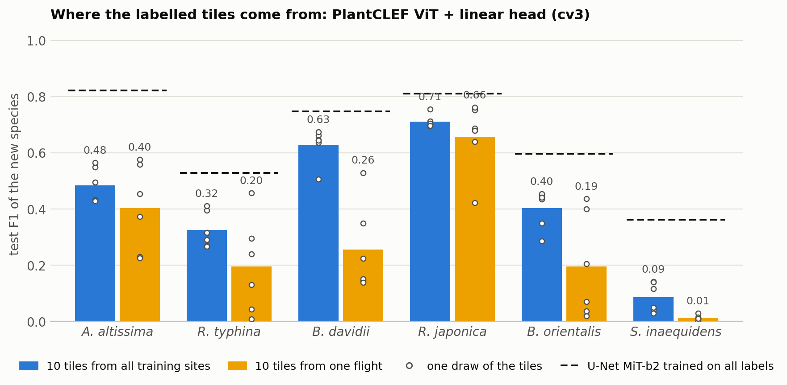

# Few-shot evaluation of the PlantCLEF ViT: motivation, method and results (2026-11-19)

Branch `plantclef2024`. Code: [fewshot_probe.py](../fewshot_probe.py), [datasets/neophyte_dataset.py](../datasets/neophyte_dataset.py)
(`random_flight`), [scripts/plot_fewshot.py](../scripts/plot_fewshot.py). Queues:
[queue_2026-11-16_fewshot_loso.sh](../scripts/queues/queue_2026-11-16_fewshot_loso.sh),
[queue_2026-11-18_fewshot_extra.sh](../scripts/queues/queue_2026-11-18_fewshot_extra.sh).
Background on the PlantCLEF model: [plantclef2024_vit_notes_en.md](plantclef2024_vit_notes_en.md); full-data results of the
ViT encoders: [plantclef2024_vit_results/README.md](plantclef2024_vit_results/README.md).

**Where the numbers come from:** all from `results/fewshot/loso/summary.txt` (version after the queue finished on
2026-11-19 03:33). Copies are in [plantclef2024_fewshot_results/](plantclef2024_fewshot_results/)
(`summary_loso_2026-11-19.txt/.csv`, `paired_pc24_vs_dinov2_2026-11-19.txt`, `figures/`). The October numbers come from
[summary_cv3_bdavidii_2026-10-31.txt](plantclef2024_fewshot_results/summary_cv3_bdavidii_2026-10-31.txt).
The per-species F1 of the "full-data MiT-b2" comes from `results/cv/512_dev_mit_b2/cv_runs.csv` (mean of the two seeds per fold).
Statements marked **[hypothesis]** are interpretations, not direct results of an experiment.

---

## 0. Conclusions

1. **With few labels, the PlantCLEF features are the most useful.** With each species in turn as the "new" species and
   only 10 labelled tiles (cv3), a frozen PlantCLEF ViT + linear head reaches a mean new-species F1 of **0.439**,
   DINOv2 **0.366** and ImageNet MiT-b2 **0.169**. PlantCLEF beats DINOv2 on all 6 species and in 32 of 36 paired draws
   (Wilcoxon p = 2e-8). The full-data ranking (MiT-b2 0.683 > PlantCLEF 0.611) is reversed.
2. **The gap comes from the features, not from the training protocol.** On B. davidii, both encoders were run through
   "frozen + linear head" and "base training + fine-tuning": PlantCLEF gives 0.57–0.59 with both protocols, MiT-b2 only
   0.16–0.21 with both. This was only tested on B. davidii, the worst case for a MiT-b2 base; on the teammates' flights
   for the other species a fine-tuned MiT-b2 is about as good (section 3.5).
3. **Where the labels come from matters.** With the same 10 tiles taken from a single flight, the mean F1 drops from
   0.439 to **0.287**. It drops for all 6 species and depends strongly on which flight is used (B. davidii: 0.14–0.53).
   Ten tiles spread over several sites are worth much more than ten tiles from one place. On the 24 flights that the
   teammates also used for single-flight MiT-b2 fine-tuning, the PlantCLEF head with 10 tiles is about as good as their
   fine-tuned MiT-b2 (0.27 vs 0.27); only on B. davidii, where their MiT-b2 base is weakest, is it clearly better
   (0.26 vs 0.07). Different test sets, section 3.5.
4. **Still short of full data, with large differences between species.** At k = 10 the PlantCLEF linear head reaches
   about 68% of the full-data MiT-b2 (cv3). R. japonica and B. davidii come close to full data (84–88%);
   S. inaequidens is barely learned (0.09; even full data only gives 0.36).
5. **Main limitations:** the linear head is weak on the known species (0.41–0.53, mean 0.45, vs about 0.65 for full-data b2);
   the features-vs-protocol 2×2 was only run on B. davidii; most experiments are on cv3 only.

---

## 1. Why

### 1.1 The project goal and the existing evaluation do not match

The project goal: **given a previously unannotated invasive species and only about 10 labelled tiles, find it in new
drone images.** All earlier experiments had all 6 species fully labelled and tested known species on new sites. They
measure cross-site generalisation, not "learning a new class from very few labels".

### 1.2 PlantCLEF lost with full data, but that does not settle the few-shot case

With full data, a U-Net with the PlantCLEF ViT-B/14 encoder reaches a mean species F1 of 0.611, MiT-b2 0.683
(cv1/cv3 × two seeds), so b2 stays the encoder. Two signs suggested the few-shot case could be different:

- The fewer the labels, the more pre-training matters. PlantCLEF was pre-trained for species classification on a large
  set of plant photos, so its features may already encode "which plant this is" without needing many labels.
- In the frozen-encoder phase (decoder only), PlantCLEF was clearly better than DINOv2 (0.62–0.68 vs 0.46–0.47), so its
  frozen features are useful on their own.

So the comparison has to be made directly in the few-shot setting, not inferred from full-data F1.

### 1.3 The October result was a single point

On 2026-10-30 we had only cv3, B. davidii, k = 10, 3 draws: PlantCLEF linear head 0.593, DINOv2 0.474,
MiT-b2 base + fine-tuning 0.208. A clear result, but with three gaps:

1. **One species, one fold, one k** — it could be specific to B. davidii;
2. **Features and protocol were confounded**: PlantCLEF only ran "frozen + linear head", b2 only "base + fine-tuning",
   so it was unclear which side the gap came from;
3. The linear head was weak on the known species.

This week's experiments close the first two gaps and quantify the third.

### 1.4 Teammates' results

Teammates' work on `origin/explorer` (not merged; commits of 2026-11-13 to 11-16): one species is held out, a MiT-b2
U-Net is trained on the other five, then fine-tuned with **all labelled tiles of the held-out species from one flight**
(the five known species are replayed). The test is the flights of other sites that contain the species (all tiles with
the species plus up to 20 other tiles per flight). Their finding is poor cross-site transfer (B. davidii novel F1 of only
0.02–0.14 for 6 of 8 training flights). This is the same phenomenon as our b2 fine-tuning at 0.2. To connect to their
setting I added a "single-flight draw" (section 2.2); 24 of its flights (3–5 per species) are flights they also
trained on, which gives a flight-by-flight comparison (section 3.5). Their leave-one-species-out baselines also show why
B. davidii is special: holding it out removes 15 sites from the base training, which leaves B. orientalis with about 1%
of its pixels (validation F1 0.00). **The numbers are not directly comparable**: different test
sets (theirs: flights of other sites, few negative tiles; ours: the full cv3 test set).

---

## 2. Method

### 2.1 Leave one species out

Each of the 6 species (A. altissima, R. typhina, B. davidii, R. japonica, B. orientalis, S. inaequidens) in turn is the
"new" species; the other 5 are "known". The new species gets only k labelled tiles, and we measure how much of it is
found on the test sites. We use the existing cross-validation splits, where training and test sites do not overlap
(mostly cv3, plus cv1).

### 2.2 Few-shot training subset

Training data of each head (one new species × one k × one draw):

| Part | Count | Note |
|---|---|---|
| New species | k tiles (1 / 3 / 10 / 30) | drawn from the training-site tiles that contain it |
| Known-species replay | 50 tiles per species | so the model does not only learn the new species |
| Background-only tiles | 200 | enough examples of "none of the species" |

- **Single-species tiles only** (`only_<species>`: the tile contains this species alone, or only background). So no tile
  contains an unlabelled instance of the new species.
- **Nested draws**: with the same seed, k=1 ⊂ k=3 ⊂ k=10 ⊂ k=30; the replay and background tiles do not depend on the new
  species or on k. Changes along the k curve and differences between species are therefore not caused by a different
  replay set.
- **6 draws per setting** (seeds 1–6; the ImageNet MiT-b2 linear head, cv1 and the B. davidii 2×2 have 3). Which 10 tiles
  are chosen has a large effect; a single draw is not reliable.
- **Two ways of drawing**:
  - `random`: from all training sites; the 10 tiles come from 2–9 different flights (median 5; cv3, k = 10);
  - `flight`: all k tiles from **one flight** (simulates "label it where it was found", the teammates' setting).
    Flights with at least k candidate tiles are eligible; the seeds pick different flights in turn.

### 2.3 Two kinds of methods

Both kinds start from an **encoder**, the network that turns an image into feature maps (a feature vector for every
small patch of the image). In the baseline the encoder is part of a **U-Net**, whose **decoder** (with skip connections)
turns these features back into a full-resolution mask. **Method (a) has no U-Net decoder**: a single 1×1 convolution
classifies each feature vector on its own, so almost everything has to come from the pre-trained features. Method (b)
is the baseline U-Net, encoder and decoder. Neither is meta-learning (no episodic training on many small tasks): both
are ordinary transfer learning, i.e. pre-trained weights plus a little training on the few-shot subset.

**(a) Frozen encoder + linear head (probe)** — the main method this week:

- the encoder is fully frozen;
- ViT (PlantCLEF / DINOv2, ViT-B/14): outputs of blocks 3/6/9/12 concatenated (3072 channels, stride 14 pixels);
- MiT-b2 (ImageNet weights): the four stages upsampled to stride 4 and concatenated;
- head = BatchNorm + 1×1 convolution (7 classes: background + 6 species), output bilinearly upsampled to full resolution;
- focal loss, AdamW, lr 1e-3, cosine decay, as many steps as a 30-epoch fine-tuning (460 tiles, batch 8, about 1700 steps);
- **no validation set**: a new species has no validation labels, so there is no checkpoint selection and no threshold
  tuning, as in the fine-tuning.

Note that the PlantCLEF / DINOv2 encoders here were never trained on our data, so the "new" species is as new to them as
the known ones, and the known species are learned from only 50 replay tiles. This explains why they are weak on the
known species (section 3.6).

**(b) Base training + fine-tuning** — closer to the real workflow:

1. **Base training**: the U-Net is trained normally on the 5 known species, with the new species' pixels **mapped to
   background** ([neophytes_split_cv3_train_512_holdout_bdavidii.yaml](../configs/data/neophytes_split_cv3_train_512_holdout_bdavidii.yaml)).
   This mimics reality: nobody has annotated the new species, so in older images it is background.
2. **Fine-tuning**: 30 more epochs on the same few-shot subset, lr 3e-4, with the new species' row of the classifier
   re-initialised (recipe `r3`). `ft_P_frozen` uses the same recipe with the ViT frozen throughout (decoder and head only).

One base training takes 7–12 hours per species, so (b) was only run for B. davidii.

Method names:

| Method | Encoder | Protocol |
|---|---|---|
| `probe_pc24` | PlantCLEF ViT (pre-trained weights) | frozen + linear head |
| `probe_dinov2` | DINOv2 ViT (pre-trained weights) | frozen + linear head |
| `probe_mit_b2` | MiT-b2 (ImageNet) | frozen + linear head |
| `probe_A` | encoder of base A (MiT-b2 U-Net, without B. davidii) | frozen + linear head |
| `ft_A_r3` | base A | base + fine-tuning |
| `ft_C_r3` | base C (MiT-b2 + nDSM U-Net) | base + fine-tuning |
| `probe_P` | ViT of base P (PlantCLEF U-Net, without B. davidii) | frozen + linear head |
| `ft_P_r3` | base P | base + fine-tuning |
| `ft_P_frozen` | base P | base + fine-tuning, ViT frozen |

### 2.4 Testing and metrics

- **Full test set at full resolution.** The ViT linear heads use 512-pixel sliding windows (the training size); MiT-b2
  takes whole tiles (as in the baseline evaluation). False positives on background tiles count.
- **F1**: pixel-level, argmax over the 7-class softmax, from the confusion matrix accumulated over the whole test set.
  No threshold tuning.
- **AP**: average precision of the new species, threshold-free (1000-bin score histograms). Shows whether a low F1 is
  only a threshold problem while the ranking is right.
- **known_F1**: mean F1 of the same model on the other 5 species — how much of the known species is kept while learning
  the new one.
- **Paired comparison**: PlantCLEF and DINOv2 use exactly the same tiles (same new species, k and seed), so they can be
  compared pair by pair: number of wins and a Wilcoxon signed-rank test.

### 2.5 Experiment grid

| What | Fold | k | Species | Draw | Draws |
|---|---|---|---|---|---|
| PlantCLEF vs DINOv2 linear heads | cv3 | 1, 3, 10, 30 | 6 | random | 6 |
| Same, other fold | cv1 | 10 | 6 | random | 3 |
| ImageNet MiT-b2 linear head | cv3 | 10 | 6 | random | 3 |
| PlantCLEF linear head, single flight | cv3 | 10 | 6 | flight | 6 |
| 2×2 (features × protocol) | cv3 | 10 | B. davidii | random | 3 |

One probe job = 18 heads (6 species × 3 draws) trained one after the other, then **one** pass over the test set scores
all of them (shared features). A job takes about 67 minutes and 6 GiB of GPU memory when it has the GPU to itself (135–154 minutes while the U-Net
lane of the first queue ran alongside; MiT-b2: 112 minutes, 35 GiB). The first queue ran 2026-11-16 14:14 → 11-17 11:49
(two lanes in parallel), the second 11-18 15:28 → 11-19 03:33: about 34 hours of wall-clock time, about 52 hours of
summed job time. Every job exited with 0.

### 2.6 Correctness check

The first 3 heads for cv3, B. davidii, k = 10 use exactly the same tiles as in October (the script checks the list of
training tiles), so their F1 should reproduce the October result:

| Draw | 11-16 | 10-30 | Difference |
|---|---|---|---|
| 1 | 0.661 | 0.659 | +0.002 |
| 2 | 0.646 | 0.640 | +0.006 |
| 3 | 0.506 | 0.481 | +0.024 |

All within 0.03, same tiles. The remaining difference comes from GPU non-determinism (bf16, data-loading order); treat
**about 0.02 as the repeat noise of a single head**.

---

## 3. Results

### 3.1 Main result: each species in turn as the new one (cv3, k = 10)



New-species F1 (mean of 6 draws, min–max in brackets; ImageNet MiT-b2: 3 draws):

| Species | PlantCLEF | DINOv2 | MiT-b2 ImageNet | Full-data MiT-b2 U-Net |
|---|---|---|---|---|
| A. altissima | **0.484** (0.43–0.57) | 0.396 (0.34–0.44) | 0.186 | 0.822 |
| R. typhina | **0.325** (0.27–0.41) | 0.215 (0.09–0.29) | 0.073 | 0.528 |
| B. davidii | **0.628** (0.51–0.67) | 0.513 (0.38–0.57) | 0.070 | 0.748 |
| R. japonica | **0.711** (0.69–0.76) | 0.630 (0.54–0.71) | 0.366 | 0.811 |
| B. orientalis | **0.402** (0.29–0.45) | 0.360 (0.26–0.45) | 0.279 | 0.597 |
| S. inaequidens | **0.086** (0.03–0.14) | 0.081 (0.03–0.17) | 0.044 | 0.362 |
| **Mean** | **0.439** | 0.366 | 0.169 | 0.645 |

- PlantCLEF has the highest mean on **6/6 species**; pair by pair it beats DINOv2 in 32/36 draws, by +0.074 on average
  (p = 1.9e-8).
- The frozen ImageNet MiT-b2 features are nearly useless (0.169): the best encoder with full data is the worst with few
  labels.
- Precision and recall (means of 6 draws): R. typhina has recall 0.66 but precision only 0.22 (many false positives);
  B. orientalis, A. altissima and S. inaequidens are the opposite, with precision clearly above recall (many misses).

### 3.2 Another fold (cv1, k = 10, 3 draws)



| Species | PlantCLEF | DINOv2 | Full-data MiT-b2 |
|---|---|---|---|
| A. altissima | **0.361** | 0.233 | 0.849 |
| R. typhina | **0.111** | 0.075 | 0.596 |
| B. davidii | **0.637** | 0.450 | 0.875 |
| R. japonica | **0.931** | 0.895 | 0.982 |
| B. orientalis | 0.366 | **0.427** | 0.753 |
| S. inaequidens | **0.121** | 0.109 | 0.278 |
| **Mean** | **0.421** | 0.365 | 0.722 |

The conclusion mostly holds: +0.056 on average, 14/18 pairs better (p = 0.009), but DINOv2 is better on B. orientalis
(3 draws, ranges overlap a lot). R. typhina reaches only 0.11 on cv1, much lower than on cv3; R. japonica on cv1 is
close to full data. How hard a species is depends on the fold.

### 3.3 Features or protocol: the B. davidii 2×2 (cv3, k = 10, draws 1–3)



For a fair comparison this table uses draws 1–3 only (the tiles used by the fine-tuning):

| | Frozen features + linear head | Base training + fine-tuning |
|---|---|---|
| **MiT-b2** | `probe_A` 0.158 (known 0.610) | `ft_A_r3` 0.208 (known 0.564) |
| **PlantCLEF** | `probe_P` 0.584 (known 0.582) | `ft_P_r3` 0.591 (known 0.507)<br>`ft_P_frozen` 0.574 (known 0.500) |

For reference, linear heads on the pre-trained encoders without base training: PlantCLEF 0.604, DINOv2 0.459,
ImageNet MiT-b2 0.070. Fine-tuning b2 + nDSM (`ft_C_r3`, October) gives 0.336.

- **Within each row the protocol barely matters** (PlantCLEF 0.57–0.59, b2 0.16–0.21); **between the rows the gap is
  0.4**. The gap comes from the features.
- After training on the 5 known species (with B. davidii as background), the PlantCLEF ViT still gives 0.584 with a linear
  head, close to the 0.604 before. Base training did not "train away" the information about the new species.
- For PlantCLEF, fine-tuning is no better than a linear head (0.591 vs 0.584), and unfreezing the ViT does not help
  either (0.591 vs 0.574, within noise). Ten tiles are not enough for the decoder or the encoder to learn anything beyond
  what a linear head already gets.
- `probe_P` is the only method that is **reasonable on both the new and the known species** (0.584 / 0.582); its
  known-species F1 is close to the 0.61 of b2 base.

### 3.4 How many labels are needed (cv3, 6 draws)



| k | PlantCLEF | DINOv2 | Paired difference | PlantCLEF better | p |
|---|---|---|---|---|---|
| 1 | 0.116 | 0.098 | +0.018 | 19/36 | 0.06 |
| 3 | 0.243 | 0.190 | +0.053 | 28/36 | 7e-6 |
| 10 | 0.439 | 0.366 | +0.074 | 32/36 | 2e-8 |
| 30 | 0.481 | 0.414 | +0.068 | 35/36 | 6e-11 |

Full-data MiT-b2: 0.645.

- k = 1 is essentially unusable (except R. japonica at 0.48), and draws vary enormously (R. japonica 0.01–0.75): whether
  the one tile is a good one decides everything.
- The largest gain is from k = 3 to 10 (+0.20); 10 to 30 adds only +0.04. On average, **around 10 tiles is past the
  knee**; more labels give smaller returns.
- Species differ: A. altissima still rises from 0.48 to 0.60; R. japonica drops slightly at k = 30 (0.711 → 0.676, lower
  precision). The cause was not investigated and may be draw noise.
- The PlantCLEF advantage over DINOv2 is consistent from k = 3 on and grows more consistent with k (35/36).

### 3.5 Where the labels come from: random over sites vs single flight (cv3, PlantCLEF, k = 10, 6 draws)



| Species | Random (several sites) | Single flight | Single-flight range |
|---|---|---|---|
| A. altissima | 0.484 | 0.403 | 0.23–0.58 |
| R. typhina | 0.325 | 0.196 | 0.01–0.46 |
| B. davidii | 0.628 | 0.256 | 0.14–0.53 |
| R. japonica | 0.711 | 0.657 | 0.42–0.76 |
| B. orientalis | 0.402 | 0.195 | 0.02–0.44 |
| S. inaequidens | 0.086 | 0.012 | 0.00–0.03 |
| **Mean** | **0.439** | **0.287** | |

- All 6 species drop; B. davidii, B. orientalis and S. inaequidens (from an already low level) lose more than half.
- Single-flight results depend heavily on the flight: B. davidii gives 0.53 from Dietikon_1_2 and 0.14 from
  Dietikon_1_1; B. orientalis gives 0.44 from Basel_3_1 and 0.02 from Ardon_1_2.
- This matches the teammates' "poor cross-site transfer": part of it is not the model but **labels that cover only one
  place**.

**Same flights as the teammates.** 24 of our single-flight draws use a flight that the teammates also used as the
training flight of a MiT-b2 base + fine-tuning run (`origin/explorer`, figures
`notebooks/few_shot_site_figures/<species>_finetune.png`, commit 75f9742). Theirs: MiT-b2 base on the other 5 species,
fine-tuned on all labelled tiles of the held-out species in that flight (`novel_f1`). Ours: frozen PlantCLEF + linear
head, 10 tiles of that flight (mean over draws when a flight was drawn twice, A. altissima only).

| Species | Shared flights | Teammates: MiT-b2 base + fine-tune, whole flight | Ours: PlantCLEF head, 10 tiles | Ours higher |
|---|---|---|---|---|
| A. altissima | 3 | 0.480 | 0.400 | 1/3 |
| R. typhina | 4 | 0.138 | 0.160 | 2/4 |
| B. davidii | 4 | 0.071 | 0.262 | 4/4 |
| R. japonica | 4 | 0.654 | 0.635 | 1/4 |
| B. orientalis | 4 | 0.316 | 0.270 | 1/4 |
| S. inaequidens | 5 | 0.053 | 0.015 | 1/5 |
| **All 24 flights** | 24 | **0.267** | **0.274** | **10/24** |

Per flight for B. davidii (teammates / ours): Basel_4_4 0.103 / 0.145, Chamoson_1_2 0.016 / 0.151, Dietikon_1_2
0.107 / 0.529, Dornach_2_1 0.058 / 0.224.

- **Overall a tie.** A frozen PlantCLEF head with 10 tiles matches a MiT-b2 base fine-tuned on the whole flight. Without
  B. davidii the teammates are slightly ahead (0.307 vs 0.277), mainly on A. altissima and B. orientalis.
- **B. davidii is the exception.** Holding out B. davidii removes 15 sites from the teammates' base training, so that
  MiT-b2 base is the weakest of their six (validation F1 0.676; B. orientalis 0.00). B. davidii is the most widespread
  species, so any "base on the other 5" loses most there: either many sites are dropped (teammates) or B. davidii is
  labelled background everywhere (our 2×2, section 3.3). The ≈ 0.4 encoder gap of section 3.3 may therefore be specific
  to B. davidii.
- **Same species ranking on both sides**: R. japonica easy, R. typhina and S. inaequidens hardly work, with completely
  different models and protocols. The difficulty is mostly the species, not the method.
- **Labels from one place limit both models.** Both drop strongly from the training flight to other sites; with the same
  model, spreading the 10 tiles over several sites lifts the mean from 0.29 to 0.44 (table above).
- The two test sets differ: theirs is the flights of other sites that contain the species (every tile with it plus up to
  20 other tiles per flight), ours is the full cv3 test set. Their test has fewer negative tiles, which, if anything,
  favours precision on their side. So the table is a rough side-by-side, not an exact difference; an exact comparison
  needs the PlantCLEF head evaluated on their split.

### 3.6 Known species

Known-species F1 of the linear heads (k = 10, cv3; range over the 6 new species): PlantCLEF 0.41–0.53 (mean 0.45),
DINOv2 0.35–0.46 (mean 0.39), ImageNet MiT-b2 0.17–0.24 (mean 0.20); full-data MiT-b2 about 0.65. Methods with base training are much higher: `probe_A` 0.61,
`probe_P` 0.58, `ft_A_r3` 0.56, `ft_P_r3` 0.51. Fine-tuning costs some known-species F1 (b2 0.61 → 0.56,
P 0.58 → 0.51).

---

## 4. Interpretation

### 4.1 Why PlantCLEF wins with few labels but loses with full data

The limiting factor is different in the two regimes:

- **Full data**: there are enough labels to adapt the encoder to drone images, and the bottleneck becomes spatial detail.
  One ViT token covers about 14 pixels (about 3 cm), coarser than the stride-4 features of MiT-b2 for small objects and
  boundaries, so b2 wins.
- **Few labels**: 10 tiles are not enough to learn new features; the model can mostly use only what is **already** in the
  pre-trained features, and the bottleneck becomes whether those features encode species. PlantCLEF was trained for
  fine-grained plant species classification, so its features are organised by plant species; DINOv2 is general
  self-supervised, with the information present but less concentrated; the shallow ImageNet MiT-b2 features mostly
  encode texture and colour, with little species semantics. The ranking (0.44 > 0.37 > 0.17) follows exactly this order.
  **[hypothesis, consistent with the 2×2]**

### 4.2 Why MiT-b2 base + fine-tuning only reaches 0.2

The 2×2 shows that the fine-tuning recipe is not the problem (`probe_A`, with the same encoder, gives only 0.16). The b2
features were trained for 5 known species + background, and B. davidii was labelled as background throughout base
training, so the encoder had no reason to keep what distinguishes it. **[hypothesis]**
The same base training did not hurt the PlantCLEF ViT (0.604 → 0.584), possibly because most of the ViT's knowledge comes
from pre-training and the training used layer-wise learning-rate decay, so the lower layers changed little.
**[hypothesis, not tested separately]**
b2 + nDSM reaching 0.34 shows that structural information such as "tall, woody" partly transfers to a new woody species.

### 4.3 Why species differ so much

- **R. japonica (0.71) and B. davidii (0.63) are easy**: also high-scoring with full data; continuous canopy, distinctive
  appearance, directly separable with pre-trained features.
- **S. inaequidens (0.09) is barely learned**: a small herb, only 0.36 even with full data, and the species the full-data
  ViT U-Net missed most (89% of its pixels predicted as background, vs 62% for MiT-b2). The 3 cm ViT token is too coarse for it, and few labels make it
  worse. A few-shot method will not fix this; it needs finer features (e.g. a b2 + PlantCLEF fusion).
- **R. typhina (0.33) has many false positives**: recall 0.66 but precision 0.22; the model labels many other things as
  R. typhina. Which classes it is confused with was not broken down.
- **A. altissima has not saturated at k = 30**: it still rises clearly (0.48 → 0.60), so it needs more labels to cover its
  variation in appearance.

### 4.4 Why a single flight is worse

Tiles from one flight share acquisition time, lighting, phenological phase and surrounding vegetation, so 10 tiles from
one flight carry about as much information as "10 variants of one tile". Ten random tiles come from 2–9 flights (median 5) and
cover different sites and phenology, so the linear head learns features that hold across sites. The several-fold
differences between flights suggest that how typical the species looks in that flight, and whether its phenological phase
matches the test sites, matters a lot. **[hypothesis]**

**Practical implication**: with a limited labelling budget, labelling 2–3 tiles in each of several places is better than
10 tiles in one place.

### 4.5 How far from full data

PlantCLEF linear head / full-data MiT-b2 (cv3): 68% on average at k = 10, 75% at k = 30.
Per species at k = 10: R. japonica 88%, B. davidii 84%, B. orientalis 67%, R. typhina 62%, A. altissima 59%,
S. inaequidens 24%. For large, distinctive species, 10 labels are already close to full data; for small herbs they are far
from it.

---

## 5. Limitations

1. **Weak on known species**: a pure linear head learns the known species from only 50 replay tiles each, reaching only
   0.41–0.53. Deployment needs a base model. `probe_P` (base ViT of the PlantCLEF U-Net + linear head) is around 0.58 on
   both new and known species and is a promising direction, but it was tested on one species only.
2. **The 2×2 covers only B. davidii with 3 draws, and B. davidii is the worst case for a MiT-b2 base** (most widespread
   species; section 3.5). On the teammates' flights for the other species, MiT-b2 base + fine-tune is about as good as
   the PlantCLEF head. "Features, not protocol" is untested on other species (each needs two
   7–12 hour base trainings).
3. **Folds**: the full grid is on cv3 only; cv1 has only k = 10 with 3 draws. cv3 happens to be the fold where the ViT lost
   most with full data.
4. **Optimistic p-values**: the Wilcoxon test treats the 36 pairs as independent, but the 6 draws of one species are not.
   The more robust statement is "the mean is higher for all 6 species (cv3); 5/6 on cv1".
5. **No threshold tuning**: F1 uses the argmax, without calibration. A new species has no validation set, so a threshold
   could not be tuned anyway; AP ranks the methods the same way as F1, so the conclusions hold, but the absolute F1 may
   underestimate what is achievable.
6. **Repeated flights in the single-flight draws**: only 4 flights have at least 10 candidate tiles of A. altissima, so
   seeds 5 and 6 use the same flights as seeds 1 and 2 (with different tiles). All other species use 6 different flights.
7. **Not directly comparable with the teammates' numbers**: their test is the flights of other sites that contain the new
   species (all its tiles plus up to 20 other tiles per flight), and in training they drop tiles of the new species
   outside the chosen flight; we use the full cv3 test set and label the new species as background in replay tiles.
   The same-flight table in section 3.5 is therefore a comparison of direction and size, not an exact difference.
8. **Single-head repeat noise is about 0.02** (section 2.6): do not interpret differences below that.

---

## 6. Next steps

1. **Extend `probe_P` to other species**: it also keeps the known species and is the closest to a deployable approach.
   Needs one PlantCLEF U-Net base training per held-out species.
2. **Combined approach (can be estimated without new experiments)**: b2 base for the known species (about 0.61), a
   PlantCLEF linear head for the new species (about 0.44–0.63).
3. **b2 + PlantCLEF fusion**: b2 for detail, frozen PlantCLEF for species semantics. Most likely to help small species
   such as S. inaequidens.
4. **Calibration without a validation set**: e.g. leave-one-out within the k tiles, or logit adjustment.
5. **Labelling strategy**: few labels at many sites vs many labels at one site is worth turning into guidance for
   annotators, after checking it at more values of k (e.g. 5 flights × 2 tiles).

---

## 7. Reproduction

```bash
# the two queues (shared GPU: check nvidia-smi first; finished jobs are skipped)
bash scripts/queues/queue_2026-11-16_fewshot_loso.sh probes   # grid of linear heads
bash scripts/queues/queue_2026-11-16_fewshot_loso.sh unet     # B. davidii base P + fine-tuning
bash scripts/queues/queue_2026-11-18_fewshot_extra.sh         # draws 4-6 + ImageNet MiT-b2 linear head

# single jobs
python fewshot_probe.py probe --backbone pc24 --fold cv3 --new_species all --k 10 \
    --seeds 1 2 3 --method probe_pc24 --out results/fewshot/loso/cv3_pc24_k10
python fewshot_probe.py probe --backbone pc24 --fold cv3 --new_species all --k 10 --draw flight \
    --seeds 1 2 3 --method probe_pc24 --out results/fewshot/loso/cv3_pc24_k10_flight

# summary and figures (CPU)
python fewshot_probe.py summary --root results/fewshot/loso
python scripts/plot_fewshot.py
```

| Location | Contents |
|---|---|
| `results/fewshot/loso/<fold>_<method>_k<k>[_flight][_s456]/` | one `.json` per head (confusion matrix, per-class F1/P/R, AP, training tiles) and its `_head.pt` |
| `results/fewshot/loso/summary.txt`, `summary.csv` | summary tables |
| `results/fewshot/loso/paired_pc24_vs_dinov2.txt` | paired comparison |
| `results/fewshot/loso/figures/` | figures 1–4 |
| `lightning_logs/queue_2026-11-16_fewshot_loso/status.txt` | queue log, sanity lines |
| [plantclef2024_fewshot_results/](plantclef2024_fewshot_results/) | copies of the summaries and figures above (`results/` is not in git) |
