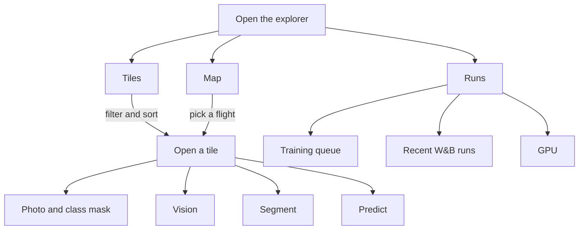

# Tile explorer

Local viewer for the drone tiles the baseline trains on (U-Net + MiT-b2, fold cv3 by default). It does not use the training conda env. Everything below runs from this folder, in `explorer/.venv`.

The catalog is one Parquet row per tile, queried with DuckDB. Thumbnails are 256px WebP files, so the grid never opens a full GeoTIFF.

## In the browser

The page opens on the tile grid for cv3 train. Switch to Map to see one flight, or to Runs to watch the GPU, recent W&B runs, and the training queue. Open a tile to look at the photo and its labels, try image filters, ask for a zero-shot mask, or run a trained checkpoint. The label switch next to Show labels draws either the species mask or the phenology mask (non-flowering, flowering, fruiting). Stage chips in the filter bar keep tiles that have labelled pixels in the chosen stages.



## Setup

```bash
cd explorer
python3 -m venv .venv
.venv/bin/pip install -r requirements.txt
cd web && npm install
```

## Run

```bash
cd explorer
./run.sh
```

`run.sh` prepares the cache, then starts the API on port 8000 and the Vite dev server on port 5173. Ctrl+C stops both. Open http://127.0.0.1:5173 . The dev server proxies `/api`, `/thumbs`, and `/masks` to the API.

Prepare runs only what is missing:

- `build_catalog.py` when `cache/tiles.parquet` is absent.
- `build_thumbnails.py` every time. It skips a tile that already has a thumbnail, a mask, a stage mask when the tile is labelled, and a row in `cache/raster_meta.parquet`.
- `build_grid.py` when `cache/grid.parquet` is absent, or older than the catalog.

The first thumbnail pass is about 42,000 tiles and takes a while. Later starts only check that the cache is complete.

The page opens on cv3 train, sorted by labelled area, with the class mask drawn over each thumbnail. Map stitches one flight from `cache/grid.parquet`.

Open a tile and choose Vision to preview OpenCV filters and a gray-value histogram on that tile. The preview is computed in memory and is not written to disk. It does not change the thumbnails, the catalog, or the training data.

Choose Segment to run a zero-shot mask on that same preview. The tab offers YOLOE-26s, which takes a text phrase, and SAM 2.1 tiny, which takes include and exclude points and boxes. Neither model is trained on the six neophytes, so the overlay is only a visual test. The first text prompt downloads `yoloe-26s-seg.pt` and a MobileCLIP encoder into `cache/weights` (about 254 MB for the encoder) and needs network access. That first call also installs the Ultralytics CLIP fork if it is missing (`pip install git+https://github.com/ultralytics/CLIP.git`). The mask is returned in the response and is not saved.

## Predict, runs, and the GPU

The explorer API stays in `explorer/.venv`. Prediction and training use the repo-root `.venv` from `pyproject.toml`. Create it once from the repo root:

```bash
uv sync
```

Choose Predict on an open tile, pick a checkpoint under `lightning_logs/`, and run it. The forward pass matches `test.py`: the whole tile at its own resolution, patching off. The overlay uses the same class colors as the ground-truth label. Photo, Labels, Prediction, Compare, and Importance are separate views, so the two masks are not blended. Compare can split them with a wipe or show agreement: a fill matches the label, a white edge is extra, an outline was missed, and a colored edge is the label where the class is wrong. A half-resolution (`_ds2`) run is scaled down before the forward pass, the same way its test config does. A checkpoint that was trained with an nDSM reads that tile's DSM and DTM. The first load of an architecture can take a while. A successful run is saved under `cache/predictions/` and loads again without the GPU, including while a training job is running. Re-run computes it again. Clear saved drops that tile and checkpoint; Clear all drops every saved prediction. Free GPU unloads the prediction model only. A new prediction is refused while a training job is running, so the two do not share the GPU.

Runs is the third view in the header. It lists recent runs from the W&B project `max-zehnder-university-of-z-rich/ai4good-neophytes`. If the panel says W&B is not logged in, run `uv run wandb login` once from the repo root. The same view has a form for a new training job and tails that job's log. Queue run writes the job to `explorer/cache/jobs/` and starts it in tmux (`np-<id>`) when `nvidia-smi` shows no compute process. Only one job runs at a time. Clear cancels every job still waiting and hides finished rows. Hide on one finished row removes that row. A running job stays, and its log file stays on disk. Turn Subset on to limit training and validation to a number of tiles per species; with it off the job uses the whole split. The species field starts with every species. Remove one to leave its tiles out of the subset. Train on flights limits training and validation to the flights you tick. Leave it empty for every flight in the split. Each flight row shows its date, the species labelled there, and the share of non-flowering, flowering, and fruiting pixels. A site name selects every flight of that site. Val F1 is then same-flight and test F1 is the fold's other sites. Train stages starts with all three. Turn one off to ignore that stage: those pixels are not learned as background, and tiles with none of the chosen stages are dropped. The test split stays unfiltered, so the test score still includes the stages left out of training. The W&B name field starts as the name the queue would assign; edit it to choose another. With flights, stages, or Subset narrowed, that default also gains a tag, such as fl_Aarau_3_1-Rueti_1_1, stnonflower, or t10_v10_tbg10_vbg0. The extra lines are `key=value` Hydra overrides with no spaces. The header readout (`GPU 84% · 18/24 GB`) stays visible on Tiles and Map.

The API is bound to `127.0.0.1` because it can start training. Do not expose it on the network.

## The prepare scripts

You can run them by hand from `explorer/` with `.venv/bin/python`. `run.sh` calls the same commands.

```bash
python build_catalog.py
python build_thumbnails.py
python build_grid.py
```

`build_catalog.py` reads `../data/Neophytes/stats_imagewise.csv` and the `split_cv*.yaml` files. A tile's CV role is the role that file assigns to its folder, which is not the same thing as the on-disk `train` / `val` / `test` folder. For cv3, training uses the train and test folders of sites that are not held out; the test set is the train folders of Dornach_1, Rivera_1, Basel_2, and Waltenschwil_1.

`build_thumbnails.py` is resumable. `--limit 20` processes a short trial run. `--workers` sets the process count. Labelled tiles also get a stage mask in `cache/stage_masks/`, coloured by phenology rather than species.

`build_grid.py` reads each GeoTIFF header and writes tile origins. The map view uses that file to stitch one flight.
